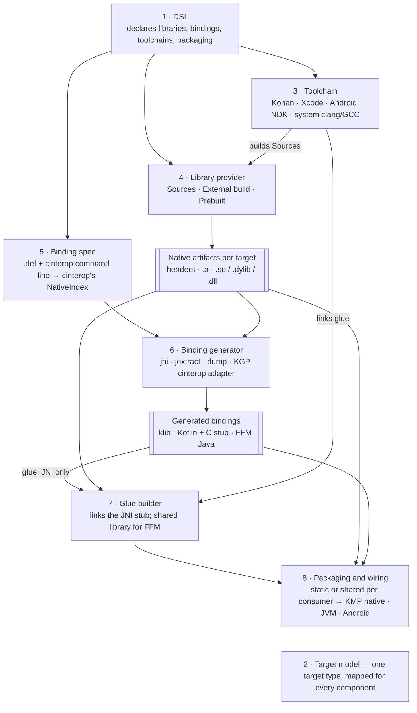

# KonanPlugin: Interop Architecture

Status: draft · 2026-10-05 · components settled; generators built and verified end to end; DSL,
packaging and provisioning still open.

## Context and goals

The plugin moves from "cinterop with a JVM hack" to a set of swappable parts: a DSL, binding
generators, toolchains and packaging, each behind an interface. Having dependencies inside an
implementation is fine; the goal is that no one implementation shapes the whole design.

The plugin started out doing three things, all tied to the Kotlin/Native distribution: it compiled C
with konan's clang, generated JNI bindings by running cinterop's undocumented JVM flavor, and rewrote
that output with regexes so strings and buffers crossed as Kotlin types. The 2.4 upgrade broke the
second of these (cinterop started looking for `jni.h` on its own). The JVM flavor and the rewriting are
now gone: every generator works from cinterop's own model of the headers (section B).

The plugin must serve two kinds of project:

| Path | Example | Who builds the native code | What the plugin must do |
| --- | --- | --- | --- |
| **Seam** | A few C/C++ files next to Kotlin Multiplatform code | The plugin, for every target | Compile, link, generate bindings, package |
| **Systems integration** | OpenGL headers, JUCE, ggml | An existing build (CMake, the vendor) or a prebuilt binary | Generate bindings against headers, bring in the binaries, package |

The seam path is what the plugin does today. The systems path cannot rely on konan's clang: a
project like JUCE has its own build system and platform SDKs, so the plugin must accept binaries
built elsewhere.

Non-goals:

- Replacing CMake, Bazel or a vendor's build. The plugin calls them or takes their output.
- Being a general C/C++ build system. The plugin's own compile path stays for small sources.

## What the Kotlin/Native distribution ships

The distribution is two things: a JVM compiler in one 82 MB jar, and a per-host set of cross
toolchains downloaded on demand. The plugin uses the toolchains to compile C, and the jar's cinterop
code to read headers and produce bindings; everything else is Kotlin-specific. Measured on
`kotlin-native-prebuilt-macos-aarch64-2.4.20` (1.1 GB) plus `~/.konan/dependencies` (3.8 GB).

| Part | Where | What it is | Used by the plugin |
| --- | --- | --- | --- |
| Launchers | `bin/` | `konanc`, `cinterop`, `klib`, `run_konan`, `generate-platform`: shell scripts that start the jar | `run_konan clang` for compiling C |
| Compiler jar | `konan/lib/kotlin-native-compiler-embeddable.jar` (82 MB) | Compiler, cinterop (`interop.gen.jvm`), header indexer (`interop.indexer`), `ClangArgs` (per-target clang flags) | The index exporter's classpath: `buildNativeIndex`, the internal `prepareTool`/`buildNativeLibrary`, and `Interop().interop` |
| JNI helpers | `konan/nativelib/` | `libclangstubs`, `libllvmstubs`, `libkotlinxcinteropjvmcallbacks`: JNI glue so the jar can call libclang and LLVM | On the exporter's `java.library.path` |
| Target config | `konan/konan.properties` | Per host and target: which LLVM, sysroot, toolchain, libffi to use and download | Indirectly, through `run_konan` and `prepareTool` |
| Platform defs | `konan/platformDef/<target>/` | 176 `.def` files for macOS alone (AppKit, Metal, POSIX…) | No |
| Platform klibs | `klib/platform/<target>/` | Prebuilt cinterop output of those defs, 21 targets | No |
| Stdlib | `klib/common/stdlib`, `sources/` | Kotlin/Native stdlib | No |
| LLVM | `dependencies/llvm-21-…-essentials` (497 MB) | `clang`, `clang++`, `lld`, `llvm-ar`, `libclang` | clang, llvm-ar, and libclang through the indexer |
| Android toolchain | `dependencies/target-toolchain-…-android_ndk` (1.5 GB) + sysroot (546 MB) | A trimmed Android NDK | Links Android JNI libraries; compiler-rt lookup |
| Linux toolchain | `dependencies/x86_64-unknown-linux-gnu-gcc-8.3.0-glibc-2.19` (268 MB) | GCC sysroot with glibc 2.19 | Cross-compiling to Linux |
| Apple toolchain | Not downloaded | `konan.properties` points at the local Xcode | Through `run_konan` |
| libffi | `dependencies/libffi-3.3-…` | For Kotlin/Native callbacks | No |

What this means for the design:

- **The valuable part is the cross toolchain, not the compiler.** One clang plus a sysroot per
  target, already downloaded by any Kotlin Multiplatform build, is what makes the seam path work with
  zero setup. It stays as one toolchain implementation.
- **The jar's cinterop and indexer are internal APIs.** They are confined to the index exporter
  (`src/indexExporter`), which compiles against exactly one Kotlin version; nothing else in the plugin
  references them.
- **Apple targets always need Xcode.** Konan only borrows it, so an Xcode-based toolchain is not a
  loss of capability.

## System components

The system is eight components that meet at two contracts: **native artifacts per target** (headers
plus static and shared libraries, however they came to exist) and **generated bindings** (sources,
klibs and any native glue). Everything upstream of the first contract decides how binaries are made;
everything downstream decides how Kotlin reaches them. That split is what lets a prebuilt JUCE and a
three-file C seam flow through the same pipeline.



| # | Component | Responsibility | Consumes → produces | Implementations |
| --- | --- | --- | --- | --- |
| 1 | **DSL** | Declares libraries, bindings, toolchains and packaging; validates; no work of its own | Build script → model objects | Today `konanConfig {}` and `jvmInterops {}`; the redesign is section A |
| 2 | **Target model** | The plugin's own target type (OS, architecture, ABI) with mappings to every ecosystem's name | — | `KonanTarget` today, mapped to Android ABI and JVM library paths |
| 3 | **Toolchain** | Compile, archive and link C/C++ for one target | Sources + flags → `.o`, `.a`, `.so`/`.dylib`/`.dll` | Konan (clang + downloaded sysroots) today; Xcode, Android NDK, system clang/GCC/MSVC, Zig later |
| 4 | **Library provider** | Makes a library's per-target artifacts exist | Declaration → native artifacts | **Sources** (`runKonanClang`), **External build** (CMake); **Prebuilt** not yet |
| 5 | **Binding spec** | What to bind | `.def` + cinterop command line → cinterop's `NativeIndex` | cinterop itself, in the index exporter (section B) |
| 6 | **Binding generator** | Turns the spec into bindings for one kind of consumer | Index → generated bindings; or a binding → another tool's pipeline | Exporter generators **jni** (Kotlin + C stub), **jextract** (FFM Java), **dump** (text); the **KGP cinterop adapter** (`kotlinNativeInterop`) |
| 7 | **Glue builder** | Compiles and links native glue a generator emits, such as the JNI stub | Glue sources + native artifacts + toolchain → shared library | `LinkJvmInteropTask`, or an external build through the `KONAN_JNI_STUB_DIR` contract; a no-glue shared library for FFM is missing (section D) |
| 8 | **Packaging and wiring** | Picks static or shared linkage per consumer and puts bindings and binaries where that consumer loads them | Bindings + binaries → source sets, `jniLibs`, cinterop declarations, publications | JVM and Android for JNI; Kotlin/Native through the KGP adapter; FFM and publications not yet (section D) |

How the two paths use them:

- **Seam**: DSL → Sources provider with the Konan toolchain → any generator → packaging. This is
  today's plugin, with zero setup on a machine that already builds Kotlin Multiplatform.
- **Systems integration**: DSL → External or Prebuilt provider → generator against the vendor's
  headers → packaging. No toolchain is needed unless a generator emits glue (JNI) or a consumer needs a
  shared library the provider does not produce (FFM).

Rules that fall out of this:

- **Providers never know about generators, and generators never know which provider ran.** Both see
  only native artifacts per target.
- **Linkage is a provider fact and a packaging choice.** A provider declares what it can produce
  (static, shared, or both); packaging picks per consumer, for example static into a Kotlin/Native
  binary and shared on the JVM.
- **KGP and AGP types live only in component 8.** Generators run in their own process and produce
  files; everything else can be applied to a project without either plugin, which keeps the TestKit
  fixture that catches decoration failures meaningful.

## A. DSL

Not designed yet; next round. It must decide:

- Where declarations live: top-level `nativeLibraries {}` and `bindings {}` containers, or per
  compilation like `compilations["main"].cinterops {}`, or both with one referencing the other.
- How much to borrow from AGP's `externalNativeBuild { cmake { path; version } }` and
  `defaultConfig.externalNativeBuild { cmake { arguments; abiFilters } }`, where the build is declared
  once and tuned per variant.
- How a binding names its library (by reference, so provider and generator stay decoupled) and picks
  generators per consumer — section B shows each consumer has exactly one natural generator.
- Prior art to read first: the current KGP `cinterops {}` DSL, AGP `externalNativeBuild` and
  `ndk {}`, and Gradle's own `cpp-library` plugin.

## B. Generator model

Generators come in two kinds. **Exporter generators** (`jni`, `jextract`, `dump`) run in one process, the
**index exporter**, next to cinterop's model of the headers, and only generated sources leave it. A
**pipeline adapter** generates nothing itself: the KGP cinterop adapter (`kotlinNativeInterop`)
declares KGP's own `cinterops {}` for every Kotlin/Native target. Built and verified: the same
`mymath.def` produces bindings for all three consumers, each called from Kotlin with identical results
(integers, doubles, strings both ways, a read-only buffer, and a buffer the C side fills).

```
Gradle task ──javaexec──► index exporter (classpath: the distribution's compiler jar + the exporter)
  cinterop command line      CInteropArguments → prepareTool → DefFile → buildNativeLibrary
                             → buildNativeIndex  (lazy; only generators that read the index pay for it)
                             → BindingGenerator.generate(context, outputDirectory)
◄──────────────── output directory ──
```

**The spec is cinterop's own `NativeIndex`.** No model of our own: the exporter follows the steps of
cinterop's private `processCLib` up to the index, calling the internal `prepareTool` and
`buildNativeLibrary` by compiling against the compiler jar as a Kotlin friend module. A `.def` therefore
means exactly what it means to cinterop — header filters, modules, `-header`, preamble — and a Kotlin
release that changes those functions fails the exporter's compilation at the version bump.

**Why its own process.** The compiler jar bundles its own unrelocated Kotlin stdlib, and libclang can be
loaded by one classloader per JVM. In the daemon, KGP's cinterop may already have loaded it; in a Gradle
worker, the compiler ran on Gradle's stdlib (2.4.10) instead of its own (2.4.20). `javaexec` with a
classpath of exactly the compiler jar and the exporter avoids both. The distribution must be the exact
version the exporter was compiled against (`kotlinNativeVersion`, 2.4.20).

**The interface.** `BindingGenerator.generate(context, outputDirectory)`, chosen by name. The
`GenerationContext` carries the package (decided as cinterop decides it), the `.def`'s preamble, the
cinterop command line, generator options, and — built on first use — the index, the included headers
and the clang arguments.

| Exporter generator | Reads the index? | Output | Consumer | Notes |
| --- | --- | --- | --- | --- |
| `jni` | Yes, for everything | `kotlin/<pkg>/<facade>.kt` + `c/<stub>.c` | JVM, Android | Functions under their C names; strings, primitive buffers and structs by value marshalled in the stub; variadic and `long double` listed as not bound |
| `jextract` | Yes, for *what*: every indexed symbol becomes an `--include-*` filter | `java/<pkg>/*.java` | JVM 22+ (FFM) | jextract parses the headers again with its own libclang 13 |
| `dump` | Yes | `index.txt` | Tests, diffing across Kotlin versions | |

**Kotlin/Native goes through KGP, not the exporter.** A klib is a compiler artifact: it has to come from
the consumer's Kotlin version, which KGP's cinterop is and the exporter's pinned distribution is not.
The adapter also inherits what KGP does around it — a task per target, change detection,
`-Xmodule-name`, the compile dependency, commonization, IDE import and publication — and wires the
provider's archive in (`-libraryPath` to `konanConfig`'s output, the cinterop task after
`runKonanClang`). Running cinterop's pipeline in the exporter (`Interop().interop("native", …)`) was
tried and works, with a klib matching KGP's apart from the header hash and `unique_name`; it is not
used because of the version pin.

What building them showed:

- **The index decides what, the generator decides how.** JNI and FFM bind the same declarations because
  both derive their set from one index. Where a generator cannot bind something, it says so (`// Not
  bound: sample_log: variadic`); jextract, which does support varargs, binds it.
- **A second parser means translation rules.** cinterop folds `typedef union { … } bits_t` into a record
  named `bits_t`; jextract keeps it a typedef and drops it unless filtered as one, after which its Java
  did not compile. jextract also skips bit-fields and opaque structs that cinterop indexes. Each
  generator that re-parses needs a test against the dump of the same header.
- **The index is built lazily**, so a generator that needs neither the index nor the library facts does
  not pay for parsing the headers; cinterop's own pipeline also must not nest inside that setup.
- **Marshalling lives in the JNI generator.** It is generated C, not a reusable transform: FFM has its
  own marshalling (`Arena`, `MemorySegment`) and Kotlin/Native has cinterop's.

Not yet:

- **`expect`/`actual` in common code.** One Kotlin API over all three: the index decides the common
  signatures, the JNI and FFM generators the JVM `actual`s, and the native `actual`s call the API KGP's
  cinterop generates,
  whose exact shape (names, enum style, string conversion) cinterop's own `StubIr` can tell.
- **Per-target indexing for JNI.** It indexes the host only; C types that change size per target
  (`long` on Windows) need either an index per target or the wider Kotlin type.

## C. File tree layout

Partly settled by what exists:

- **Plugin source**: `src/indexExporter` is the exporter and every generator (its own source set: it
  compiles against the compiler jar, which `main` must not); `src/main/.../index` holds the launcher
  (`runIndexExporter`), the generic `GenerateFromNativeIndexTask` and `PinnedKotlinNative`;
  `buildSrc/.../native-index.gradle.kts` wires the source set, the friend path and the nested exporter
  jar. The remaining components (DSL, providers, packaging) still sit in `interop/` and `jvm/` and get
  one package each in the redesign, so "KGP and AGP types only in packaging" can be checked by package.
- **Generator output**: each exporter generator owns its layout under the task's output directory —
  `jni`: `kotlin/<package>/<facade>.kt` and `c/<stub>.c`; `jextract`: `java/<package>/`; `dump`:
  `index.txt`. Kotlin/Native klibs stay where KGP puts them.
- **Consumer build output**: still to fix, e.g. `build/native/<library>/<target>/` for artifacts and
  `build/generated/bindings/<binding>/<generator>/` for bindings, keeping the rule that only ABI-named
  directories sit under `jniLibs`.

## D. Toolchains, prebuilt binaries and packaging

Still to design. What the generators showed each consumer needs; the JNI and Kotlin/Native rows are
wired by the plugin today, the FFM row was done by hand in a verification project:

| Consumer | Binary | Glue | Wiring |
| --- | --- | --- | --- |
| Kotlin/Native | Static archive, embedded in the klib (`staticLibraries` + `-libraryPath`) | None | KGP's `cinterops {}` on each target's main compilation, declared by the adapter |
| JVM (JNI) | Shared library: stub + archive | The JNI stub | Generated Kotlin as sources; the library on `java.library.path` or in resources |
| JVM (FFM) | Shared library of the C code itself | None | Generated Java as sources, compiled with a JDK 22+ toolchain; `--enable-native-access`; the library on `java.library.path` |
| Android | Shared library: stub + archive, per ABI | The JNI stub | Generated Kotlin as sources; `jniLibs/<abi>` via the variant API. No FFM on Android |

Gaps this exposes:

- **A shared library without glue.** FFM needs `libmymath.dylib`, which neither the Sources provider
  (static only) nor the glue builder (stub + archive) produces. The glue builder needs a mode that links
  an archive into a shared library with nothing added (`-force_load` / `--whole-archive`).
- **Wiring for FFM consumers**, today written by hand: the Java source set, the JDK 22+ toolchain, the
  runtime flags.
- **Tool provisioning.** Generation needs the Kotlin/Native distribution of exactly
  `kotlinNativeVersion` in `~/.konan` (any KMP build of that version downloads it); jextract is a path
  option. The plugin should locate or download both.

Still undecided:

- How a toolchain is chosen per target: a default per host and target (Konan where available),
  overridable per library.
- How prebuilt binaries arrive: local paths per target, a Maven artifact with a classifier per
  target, or an archive to unpack; and how their headers travel with them.
- What a published library carries for its own consumers.

## Open questions

- [x] Should the cinterop generator run KGP's own cinterop task, or the plugin run cinterop itself?
      KGP's: the klib must come from the consumer's Kotlin version. `kotlinNativeInterop` adapts a
      binding to `cinterops {}`; running cinterop in the exporter was tried, works, and is not used.
- [ ] Lowest JDK for the Gradle daemon and for consumers at runtime? It decides whether FFM is a
      default or an opt-in. Header parsing no longer depends on it: it runs in the exporter's process.
- [ ] Does the `.def` stay a first-class input, or become an import format next to a header-first
      DSL? Today it is the input, read by cinterop itself.
- [ ] Is a published multi-target library (bindings plus binaries per target) in scope for the first
      release, or only in-build consumption?
- [ ] Migration: does the current `konanConfig {}` and `jvmInterops {}` DSL keep working behind the
      new model, or is this a major version with a break? The JNI bindings already changed their
      names (`my_add`, not `kniBridge0`).
- [ ] Should the plugin pin one Kotlin/Native version for generation (today) or support several, at the
      cost of one exporter build per version?
