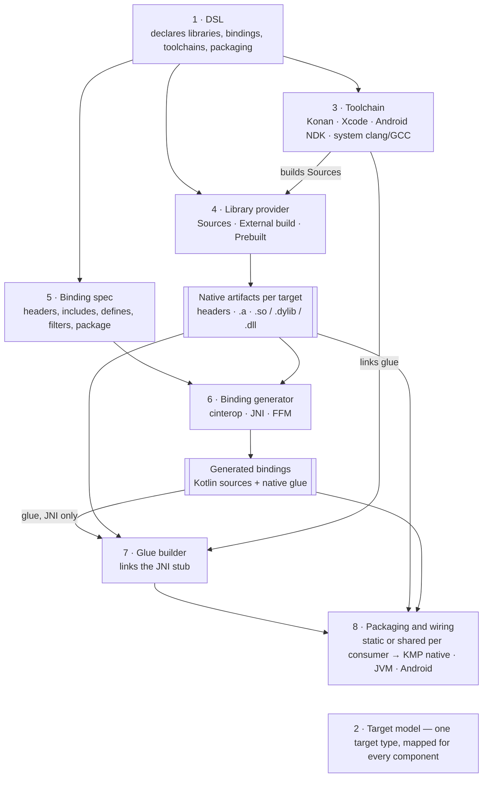

# KonanPlugin: Interop Architecture

Status: draft · 2026-09-28

## Context and goals

The plugin moves from "cinterop with a JVM hack" to a set of swappable parts: a DSL, binding
generators, toolchains and packaging, each behind an interface. Having dependencies inside an
implementation is fine; the goal is that no one implementation shapes the whole design.

Today the plugin does three things, all tied to the Kotlin/Native distribution: it compiles C with
konan's clang, generates JNI bindings by running cinterop's undocumented JVM flavor, and rewrites
that output so strings and buffers cross as Kotlin types. The 2.4 upgrade broke the second of these
(cinterop started looking for `jni.h` on its own), which shows how fragile that path is.

The plugin must serve two kinds of project:

| Path | Example | Who builds the native code | What the plugin must do |
| --- | --- | --- | --- |
| **Seam** | A few C/C++ files next to Kotlin Multiplatform code | The plugin, for every target | Compile, link, generate bindings, package |
| **Systems integration** | OpenGL headers, JUCE, ggml | An existing build (CMake, the vendor) or a prebuilt binary | Generate bindings against headers, bring in the binaries, package |

The seam path is what the plugin does today. The systems path cannot rely on konan's clang: a
project like JUCE has its own build system and platform SDKs, so the plugin must accept binaries
built elsewhere.

Non-goals:

- Replacing CMake, Bazel or a vendor's build. The plugin calls them or takes their output.
- Being a general C/C++ build system. The plugin's own compile path stays for small sources.

## What the Kotlin/Native distribution ships

The distribution is two things: a JVM compiler in one 82 MB jar, and a per-host set of cross
toolchains downloaded on demand. The plugin uses the toolchains to compile C and one internal entry
point of the jar to generate JNI bindings; everything else is Kotlin-specific. Measured on
`kotlin-native-prebuilt-macos-aarch64-2.4.20` (1.1 GB) plus `~/.konan/dependencies` (3.8 GB).

| Part | Where | What it is | Used by the plugin today |
| --- | --- | --- | --- |
| Launchers | `bin/` | `konanc`, `cinterop`, `klib`, `run_konan`, `generate-platform`: shell scripts that start the jar | `run_konan clang` for compiling C |
| Compiler jar | `konan/lib/kotlin-native-compiler-embeddable.jar` (82 MB) | Compiler, cinterop (`interop.gen.jvm.MainKt`), header indexer (`interop.indexer`), `ClangArgs` (per-target clang flags) | cinterop's JVM flavor, run as an undocumented `main` |
| JNI helpers | `konan/nativelib/` | `libclangstubs`, `libllvmstubs`, `libkotlinxcinteropjvmcallbacks`: JNI glue so the jar can call libclang and LLVM | On `java.library.path` of the generator |
| Target config | `konan/konan.properties` | Per host and target: which LLVM, sysroot, toolchain, libffi to use and download | Indirectly, through `run_konan` |
| Platform defs | `konan/platformDef/<target>/` | 176 `.def` files for macOS alone (AppKit, Metal, POSIX…) | No |
| Platform klibs | `klib/platform/<target>/` | Prebuilt cinterop output of those defs, 21 targets | No |
| Stdlib | `klib/common/stdlib`, `sources/` | Kotlin/Native stdlib | No |
| LLVM | `dependencies/llvm-21-…-essentials` (497 MB) | `clang`, `clang++`, `lld`, `llvm-ar`, `libclang` | clang, llvm-ar |
| Android toolchain | `dependencies/target-toolchain-…-android_ndk` (1.5 GB) + sysroot (546 MB) | A trimmed Android NDK | Links Android JNI libraries; compiler-rt lookup |
| Linux toolchain | `dependencies/x86_64-unknown-linux-gnu-gcc-8.3.0-glibc-2.19` (268 MB) | GCC sysroot with glibc 2.19 | Cross-compiling to Linux |
| Apple toolchain | Not downloaded | `konan.properties` points at the local Xcode | Through `run_konan` |
| libffi | `dependencies/libffi-3.3-…` | For Kotlin/Native callbacks | No |

What this means for the design:

- **The valuable part is the cross toolchain, not the compiler.** One clang plus a sysroot per
  target, already downloaded by any Kotlin Multiplatform build, is what makes the seam path work with
  zero setup. It stays as one toolchain implementation.
- **The jar's cinterop and indexer are internal APIs.** They are fine behind a generator interface,
  but nothing outside that implementation should know they exist.
- **Apple targets always need Xcode.** Konan only borrows it, so an Xcode-based toolchain is not a
  loss of capability.

## System components

The system is eight components that meet at two contracts: **native artifacts per target** (headers
plus static and shared libraries, however they came to exist) and **generated bindings** (Kotlin
sources plus any native glue). Everything upstream of the first contract decides how binaries are
made; everything downstream decides how Kotlin reaches them. That split is what lets a prebuilt JUCE
and a three-file C seam flow through the same pipeline.

| # | Component | Responsibility | Consumes → produces | Implementations |
| --- | --- | --- | --- | --- |
| 1 | **DSL** | Declares libraries, bindings, toolchains and packaging; validates; no work of its own | Build script → model objects | One, modelled on `cinterops {}` and `externalNativeBuild {}` (section A) |
| 2 | **Target model** | The plugin's own target type (OS, architecture, ABI) with mappings to every ecosystem's name | — | Maps to `KonanTarget`, Android ABI, JVM `os.name`/`os.arch`, clang triple, CMake toolchain |
| 3 | **Toolchain** | Compile, archive and link C/C++ for one target | Sources + flags → `.o`, `.a`, `.so`/`.dylib`/`.dll` | Konan (clang + downloaded sysroots), Xcode, Android NDK, system clang/GCC/MSVC; Zig later |
| 4 | **Library provider** | Makes a library's per-target artifacts exist | Declaration → native artifacts | **Sources** (built with a toolchain), **External build** (CMake, any command), **Prebuilt** (paths or a Maven artifact per target) |
| 5 | **Binding spec** | What to bind: headers, include paths, defines, filters, package name | Headers + DSL (or a `.def`) → one spec shared by all generators | One; `.def` read and written as an interchange format |
| 6 | **Binding generator** | Turns a spec into bindings for one kind of consumer | Spec + native artifacts → generated bindings | **cinterop** (Kotlin/Native, delegates to KGP), **JNI** (cinterop JVM flavor now, clang AST later), **FFM** (jextract) |
| 7 | **Glue builder** | Compiles and links native glue a generator emits, such as the JNI stub | Glue sources + native artifacts + toolchain → shared library | One, reusing the toolchain; or hands the glue to an external build (today's `KONAN_JNI_STUB_DIR` contract) |
| 8 | **Packaging and wiring** | Picks static or shared linkage per consumer and puts bindings and binaries where that consumer loads them | Bindings + binaries → source sets, `jniLibs`, jar resources, klib link options, publications | KMP native, JVM, Android; each in a `plugins.withId` block |

How the two paths use them:

- **Seam**: DSL → Sources provider with the Konan toolchain → any generator → packaging. This is
  today's plugin, with zero setup on a machine that already builds Kotlin Multiplatform.
- **Systems integration**: DSL → External or Prebuilt provider → generator against the vendor's
  headers → packaging. No toolchain is needed unless a generator emits glue (JNI), and then only to
  link a small stub.

Rules that fall out of this:

- **Providers never know about generators, and generators never know which provider ran.** Both see
  only native artifacts per target.
- **Linkage is a provider fact and a packaging choice.** A provider declares what it can produce
  (static, shared, or both); packaging picks per consumer, for example static into a Kotlin/Native
  binary and shared on the JVM.
- **KGP and AGP types live only in component 8 and in the cinterop generator.** Everything else can
  be applied to a project without either plugin, which keeps the TestKit fixture that catches
  decoration failures meaningful.

## A. DSL

Not designed yet; next round. It must decide:

- Where declarations live: top-level `nativeLibraries {}` and `bindings {}` containers, or per
  compilation like `compilations["main"].cinterops {}`, or both with one referencing the other.
- How much to borrow from AGP's `externalNativeBuild { cmake { path; version } }` and
  `defaultConfig.externalNativeBuild { cmake { arguments; abiFilters } }`, where the build is declared
  once and tuned per variant.
- How a binding names its library (by reference, so provider and generator stay decoupled) and picks
  generators per consumer.
- Prior art to read first: the current KGP `cinterops {}` DSL, AGP `externalNativeBuild` and
  `ndk {}`, and Gradle's own `cpp-library` plugin.

## B. Generator model

Not designed yet. It must decide:

- The interface shape: roughly `generate(spec, artifacts, target, outputDir): GeneratedBindings`,
  where the result reports Kotlin source roots, glue sources, the library name to load and runtime
  needs (JDK 22+ for FFM).
- Whether the cinterop generator produces bindings at all, or only configures KGP's own cinterop
  task, since KGP already owns that pipeline.
- Where the string and buffer marshalling lives: inside the JNI generator, or as a transform any
  generator can reuse.

## C. File tree layout

Not designed yet. Two trees need a layout:

- **Plugin source**: one package per component (`dsl`, `target`, `toolchain`, `provider`, `spec`,
  `generator/{cinterop,jni,ffm}`, `glue`, `packaging/{kmp,jvm,android}`), so the rule "KGP and AGP
  types only in packaging and the cinterop generator" can be checked by package.
- **Consumer build output**: a fixed scheme such as `build/native/<library>/<target>/` for artifacts
  and `build/generated/bindings/<binding>/<generator>/` for bindings, keeping the existing rule that
  only ABI-named directories sit under `jniLibs`.

## D. Toolchains, prebuilt binaries and packaging

Not designed yet. It must decide:

- How a toolchain is chosen per target: a default per host and target (Konan where available),
  overridable per library.
- How prebuilt binaries arrive: local paths per target, a Maven artifact with a classifier per
  target, or an archive to unpack; and how their headers travel with them.
- Packaging per consumer: static into Kotlin/Native binaries via the klib's link options, shared on
  the JVM (resources extracted at load, or `java.library.path`), shared under `jniLibs/<abi>` on
  Android, and what a published library carries for its own consumers.

## Open questions

- [ ] Should the cinterop generator run KGP's own cinterop task, or should the plugin run cinterop
      itself so all three generators behave the same way?
- [ ] Lowest JDK for the Gradle daemon and for consumers at runtime? It decides whether FFM is a
      default or an opt-in, and whether any header parsing can run in-process.
- [ ] Does the `.def` stay a first-class input, or become an import format next to a header-first
      DSL?
- [ ] Is a published multi-target library (bindings plus binaries per target) in scope for the first
      release, or only in-build consumption?
- [ ] Migration: does the current `konanConfig {}` and `jvmInterops {}` DSL keep working behind the
      new model, or is this a major version with a break?
