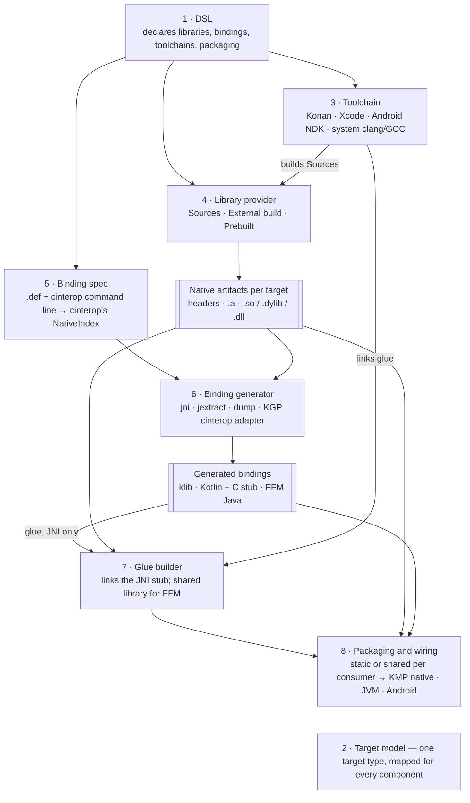

# KonanPlugin: Interop Architecture

Status: draft · 2026-10-05 · components settled; generators built and verified end to end; DSL,
packaging and provisioning still open.

## Context and goals

The plugin moves from "cinterop with a JVM hack" to a set of swappable parts: a DSL, binding
generators, toolchains and packaging, each behind an interface. Having dependencies inside an
implementation is fine; the goal is that no one implementation shapes the whole design.

The plugin started out doing three things, all tied to the Kotlin/Native distribution: it compiled C
with konan's clang, generated JNI bindings by running cinterop's undocumented JVM flavor, and rewrote
that output with regexes so strings and buffers crossed as Kotlin types. The 2.4 upgrade broke the
second of these (cinterop started looking for `jni.h` on its own). The JVM flavor and the rewriting are
now gone: every generator works from cinterop's own model of the headers (section B).

The plugin must serve two kinds of project:

| Path | Example | Who builds the native code | What the plugin must do |
| --- | --- | --- | --- |
| **Seam** | A few C/C++ files next to Kotlin Multiplatform code | The plugin, for every target | Compile, link, generate bindings, package |
| **Systems integration** | OpenGL headers, JUCE, ggml | An existing build (CMake, the vendor) or a prebuilt binary | Generate bindings against headers, bring in the binaries, package |

The seam path is what the plugin does today. The systems path cannot rely on konan's clang: a
project like JUCE has its own build system and platform SDKs, so the plugin must accept binaries
built elsewhere.

Non-goals:

- Replacing CMake, Bazel or a vendor's build. The plugin calls them or takes their output.
- Being a general C/C++ build system. The plugin's own compile path stays for small sources.

## What the Kotlin/Native distribution ships

The distribution is two things: a JVM compiler in one 82 MB jar, and a per-host set of cross
toolchains downloaded on demand. The plugin uses the toolchains to compile C, and the jar's cinterop
code to read headers and produce bindings; everything else is Kotlin-specific. Measured on
`kotlin-native-prebuilt-macos-aarch64-2.4.20` (1.1 GB) plus `~/.konan/dependencies` (3.8 GB).

| Part | Where | What it is | Used by the plugin |
| --- | --- | --- | --- |
| Launchers | `bin/` | `konanc`, `cinterop`, `klib`, `run_konan`, `generate-platform`: shell scripts that start the jar | `run_konan clang` for compiling C |
| Compiler jar | `konan/lib/kotlin-native-compiler-embeddable.jar` (82 MB) | Compiler, cinterop (`interop.gen.jvm`), header indexer (`interop.indexer`), `ClangArgs` (per-target clang flags) | The index exporter's classpath: `buildNativeIndex`, the internal `prepareTool`/`buildNativeLibrary`, and `Interop().interop` |
| JNI helpers | `konan/nativelib/` | `libclangstubs`, `libllvmstubs`, `libkotlinxcinteropjvmcallbacks`: JNI glue so the jar can call libclang and LLVM | On the exporter's `java.library.path` |
| Target config | `konan/konan.properties` | Per host and target: which LLVM, sysroot, toolchain, libffi to use and download | Indirectly, through `run_konan` and `prepareTool` |
| Platform defs | `konan/platformDef/<target>/` | 176 `.def` files for macOS alone (AppKit, Metal, POSIX…) | No |
| Platform klibs | `klib/platform/<target>/` | Prebuilt cinterop output of those defs, 21 targets | No |
| Stdlib | `klib/common/stdlib`, `sources/` | Kotlin/Native stdlib | No |
| LLVM | `dependencies/llvm-21-…-essentials` (497 MB) | `clang`, `clang++`, `lld`, `llvm-ar`, `libclang` | clang, llvm-ar, and libclang through the indexer |
| Android toolchain | `dependencies/target-toolchain-…-android_ndk` (1.5 GB) + sysroot (546 MB) | A trimmed Android NDK | Links Android JNI libraries; compiler-rt lookup |
| Linux toolchain | `dependencies/x86_64-unknown-linux-gnu-gcc-8.3.0-glibc-2.19` (268 MB) | GCC sysroot with glibc 2.19 | Cross-compiling to Linux |
| Apple toolchain | Not downloaded | `konan.properties` points at the local Xcode | Through `run_konan` |
| libffi | `dependencies/libffi-3.3-…` | For Kotlin/Native callbacks | No |

What this means for the design:

- **The valuable part is the cross toolchain, not the compiler.** One clang plus a sysroot per
  target, already downloaded by any Kotlin Multiplatform build, is what makes the seam path work with
  zero setup. It stays as one toolchain implementation.
- **The jar's cinterop and indexer are internal APIs.** They are confined to the index exporter
  (`src/indexExporter`), which compiles against exactly one Kotlin version; nothing else in the plugin
  references them.
- **Apple targets always need Xcode.** Konan only borrows it, so an Xcode-based toolchain is not a
  loss of capability.

## System components

The system is eight components that meet at two contracts: **native artifacts per target** (headers
plus static and shared libraries, however they came to exist) and **generated bindings** (sources,
klibs and any native glue). Everything upstream of the first contract decides how binaries are made;
everything downstream decides how Kotlin reaches them. That split is what lets a prebuilt JUCE and a
three-file C seam flow through the same pipeline.



| # | Component | Responsibility | Consumes → produces | Implementations |
| --- | --- | --- | --- | --- |
| 1 | **DSL** | Declares libraries, bindings, toolchains and packaging; validates; no work of its own | Build script → model objects | `konan { libraries; bindings }` (section A) |
| 2 | **Target model** | The plugin's own target type (OS, architecture, ABI) with mappings to every ecosystem's name | — | `model.NativeTarget`: one entry per Kotlin/Native target (checked by a test against the pinned version), with family, architecture, Android ABI, library naming and Zig triple; `NativeTarget.of(konanTarget)` is the only conversion |
| 3 | **Toolchain** | Compile, archive and link C/C++ for one target | Sources + flags → `.o`, `.a`, `.so`/`.dylib`/`.dll` | Kotlin/Native's (clang + downloaded sysroots, `KonanDistribution`), also handed to external builds per target as `CC`/`CXX`/`AR` and a CMake toolchain file (`KonanToolchain`, chosen by `ExternalToolchain`); Zig brings its own; the system's for host builds |
| 4 | **Library build** | Makes a library's per-target artifacts exist | Declaration → native artifacts | Kotlin/Native's clang by default (`konanClang<Name>`); **Prebuilt** (`prebuilt { library(target, file) }`, placed by `prebuilt<Name>`); or an **`ExternalBuild`** — one `ExternalBuildTask` per target with the `ExternalVariable` contract: **CMake** (`cmake { }`), **Make** (`make { }`), **Cargo** (`cargo { }`, a Rust `staticlib` per Rust triple), **Zig** (`zig { }`) and **Generic** (`external { step { } }`); all behind `compileNativeLibrary<Name>` |
| 5 | **Binding spec** | What to bind | `.def` + cinterop command line → cinterop's `NativeIndex` | cinterop itself, in the index exporter (section B) |
| 6 | **Binding generator** | Turns the spec into bindings for one kind of consumer | Index → generated bindings; or a binding → another tool's pipeline | Exporter generators **jni** (Kotlin + C stub), **jextract** (FFM Java), **dump** (text); the **KGP cinterop adapter** (`KotlinGradlePlugin.declareCinterops`) |
| 7 | **Glue builder** | Compiles and links native glue a generator emits, such as the JNI stub | Glue sources + native artifacts + toolchain → shared library | The JNI library: the plugin's link (`LinkSharedLibraryTask`) by default, or the same `ExternalBuild`s as libraries — **CMake**, **Make**, **Generic** — with `KONAN_JNI_STUB_DIR` and `KONAN_JNI_INCLUDE_DIR` added to the contract. FFM has no glue, but the shared library it loads is built the same way: the archive linked whole by default, **Prebuilt** (`ffm { prebuilt { library(…) } }`), or an `ExternalBuild`. JNI and FFM share `BindingLibrarySpec` and `BindingLibraryWiring` |
| 8 | **Packaging and wiring** | Picks static or shared linkage per consumer and puts bindings and binaries where that consumer loads them | Bindings + binaries → source sets, `jniLibs`, cinterop declarations, publications | `BindingConsumer`: **KotlinNativeConsumer** (the KGP adapter), **JniConsumer** (JVM, multiplatform JVM, Android; own link or CMake), **FfmConsumer** (`kotlin("jvm")` only); publications not yet (section D) |

How the two paths use them:

- **Seam**: DSL → Sources provider with the Konan toolchain → any generator → packaging. This is
  today's plugin, with zero setup on a machine that already builds Kotlin Multiplatform.
- **Systems integration**: DSL → External or Prebuilt provider → generator against the vendor's
  headers → packaging. No toolchain is needed unless a generator emits glue (JNI) or a consumer needs a
  shared library the provider does not produce (FFM).

Rules that fall out of this:

- **Providers never know about generators, and generators never know which provider ran.** Both see
  only native artifacts per target.
- **Linkage is a provider fact and a packaging choice.** A provider declares what it can produce
  (static, shared, or both); packaging picks per consumer, for example static into a Kotlin/Native
  binary and shared on the JVM.
- **KGP and AGP types live only in component 8.** Generators run in their own process and produce
  files; everything else can be applied to a project without either plugin, which keeps the TestKit
  fixture that catches decoration failures meaningful.

## A. DSL

One project extension, `konan`, with a container per component: **libraries** (component 4) and
**bindings** (5 and 6). A binding names its library; consumers follow from the project's plugins and
Kotlin targets, so a build declares what it has, not how each consumer is wired.

```kotlin
konan {
    val mymath = libraries.create("mymath") {
        targets(NativeTarget.MACOS_ARM64, NativeTarget.ANDROID_ARM64)     // sourceDirectory = native/
    }
    bindings {
        create("mymath") {
            library(mymath)                // archive per target, -staticLibrary/-libraryPath, task order
            packageName.set("example")
            jni { visibility.set(BindingVisibility.PUBLIC) }   // optional per-consumer settings
            ffm()                          // opt-in; replaces JNI in a kotlin("jvm") project
        }
    }
}
```

| The project has | The binding becomes |
| --- | --- |
| Kotlin/Native targets (`kotlin("multiplatform")`) | KGP's `cinterops {}` on each target the library is built for, archive embedded |
| `kotlin("jvm")`, multiplatform `jvm()`/Android targets, an Android app | JNI bindings in the main sources; a JNI library per target a JVM can load (host and Android, from the library's targets) |
| `ffm()` in a `kotlin("jvm")` project | jextract's FFM bindings in the main Java sources, the library linked as a shared library |

Choices made:

- **Containers, not per-compilation blocks.** `KotlinCompilation` is not extensible, and consumers are
  derived anyway; per-compilation declarations would repeat one binding per target.
- **A binding refers to its library as an object** (`library(mymath)`), not by name. Providers and generators stay decoupled (component
  rule 1), and the `.def` no longer needs `staticLibraries`: the plugin passes cinterop
  `-staticLibrary`/`-libraryPath` and links the archive for JNI and FFM.
- **Per-consumer settings nest under the binding** (`jni { }`, `ffm { }`), with AGP-style nested CMake
  under `jni { cmake { } }`, since only the JNI stub is ever compiled by an external build.
- **One naming scheme**: `compilerOptions`, `linkerOptions`, file and directory properties, vararg
  `targets(…)`. Tasks are `compileNativeLibrary<Name>`, `generateJni<Name>`, `linkJni<Name>[<Target>]`,
  `generateFfm<Name>`, `linkFfm<Name>`, and KGP's own `cinterop<Name><Target>`.
- **No compatibility shim** for `konanConfig`/`jvmInterops`/`kotlinNativeInterop`: a major version.

**A second library provider: Zig.** `libraries { create(…) { zig { } } }` runs the project's own
`build.zig` once per target. Adding it touched only the library side — a build task, a `zig { }`
block on the library, a Kotlin/Native → Zig triple mapping — and left bindings, generators and consumer
wiring unchanged. One Zig-built archive was then consumed by all three consumers: JNI and KGP's
cinterop in one multiplatform build (`jvm()` + `macosArm64()`), FFM in a `kotlin("jvm")` build, and a
`linuxX64` executable cross-linked from macOS. What made that possible, and what it cost:

- **The archive path is the contract, now a type.** `NativeArtifacts` writes the layout
  (`<target>/lib<name>.a` under the library's output directory) in one place and carries the targets
  and `builtBy`, the lifecycle task `compileNativeLibrary<Name>`. Bindings and consumers take a
  `NativeArtifacts` and never learn which provider ran. Zig names Windows archives `mymath.lib`; its
  provider renames on copy.
- **The selection is the block's settings**: a library's block selects its `BuildSettings`, two is an error,
  none means Kotlin/Native's clang. Every build system other than konan's clang is an `ExternalBuild` —
  the generic `external { step { } }` one, or a preset such as Zig — the same classes that build a
  binding's JNI or FFM library: commands per target, the contract as environment, the produced library
  copied into place. Only an `ExternalBuildOutput` differs per owner. A new preset is one subclass that
  adds its commands; nothing on the consumer side.
- **The target model has to map to each toolchain's triple.** Kotlin/Native targets become Zig triples
  pinned to konan's sysroots (glibc 2.19, macOS 12.0, iOS 14.0). The glibc pin is defensive: in this
  test, unpinned Zig also produced plain `strtol`. Android needs bionic, which Zig does not bundle.
- **Mixing toolchains brings runtime mismatches.** Zig's `Debug`/`ReleaseSafe` compile C with UBSan
  traps the other links cannot resolve, so the provider defaults to `ReleaseFast` — the same reason
  konan's clang passes `-fno-sanitize=undefined`.
- **The provider is decided after the build script runs**, so it is registered in `afterEvaluate`
  behind a lifecycle task that exists from the start.

Bazel would slot in the same way: `bazel build //target --platforms=…` per Kotlin/Native target, with a
platform per target and the output copied to the archive path. Its cost is the platforms and C
toolchains a Bazel workspace must declare to cross-compile, which Zig brings built in.

A **Prebuilt** provider takes an archive per target from local paths — a vendor drop — and places
each as `lib<name>.a`, so a Windows `name.lib` works unchanged; the library's targets default to the
ones it has archives for. It is not an `External`: there is nothing to run.

Still open: prebuilt archives from a Maven artifact, and publishing a
library's bindings and binaries.

## B. Generator model

Generators come in two kinds. **Exporter generators** (`jni`, `jextract`, `dump`) run in one process, the
**index exporter**, next to cinterop's model of the headers, and only generated sources leave it. A
**pipeline adapter** generates nothing itself: the KGP cinterop adapter
declares KGP's own `cinterops {}` for every Kotlin/Native target. Built and verified: the same
`mymath.def` produces bindings for all three consumers, each called from Kotlin with identical results
(integers, doubles, strings both ways, a read-only buffer, and a buffer the C side fills).

```
Gradle task ──javaexec──► index exporter (classpath: the distribution's compiler jar + the exporter)
  cinterop command line      CInteropArguments → prepareTool → DefFile → buildNativeLibrary
                             → buildNativeIndex  (lazy; only generators that read the index pay for it)
                             → BindingGenerator.generate(context, outputDirectory)
◄──────────────── output directory ──
```

**The spec is cinterop's own `NativeIndex`.** No model of our own: the exporter follows the steps of
cinterop's private `processCLib` up to the index, calling the internal `prepareTool` and
`buildNativeLibrary` by compiling against the compiler jar as a Kotlin friend module. A `.def` therefore
means exactly what it means to cinterop — header filters, modules, `-header`, preamble — and a Kotlin
release that changes those functions fails the exporter's compilation at the version bump.

**Why its own process.** The compiler jar bundles its own unrelocated Kotlin stdlib, and libclang can be
loaded by one classloader per JVM. In the daemon, KGP's cinterop may already have loaded it; in a Gradle
worker, the compiler ran on Gradle's stdlib (2.4.10) instead of its own (2.4.20). `javaexec` with a
classpath of exactly the compiler jar and the exporter avoids both. The distribution must be the exact
version the exporter was compiled against (`kotlinNativeVersion`, 2.4.20).

**The interface.** What to generate is a sealed `GeneratorRequest` — `Dump`, `Jni(stubLibrary,
visibility)`, `Jextract(library, jextract, headerClass)` — each carrying its generator's typed settings,
dispatched with an exhaustive `when` to `BindingGenerator<R>.generate(request, context, outputDirectory)`.
`ExporterInvocation` encodes a request on the exporter's command line and decodes it on the other side;
its source is compiled into both the plugin and the exporter, so the two cannot disagree. The
`GenerationContext` carries the package (decided as cinterop decides it), the `.def`'s preamble, and —
built on first use — the index, the included headers and the clang arguments.

| Exporter generator | Reads the index? | Output | Consumer | Notes |
| --- | --- | --- | --- | --- |
| `jni` | Yes, for everything | `kotlin/<pkg>/<facade>.kt` + `c/<stub>.c` | JVM, Android | Functions under their C names; strings, primitive buffers and structs by value marshalled in the stub; variadic and `long double` listed as not bound |
| `jextract` | Yes, for *what*: every indexed symbol becomes an `--include-*` filter | `java/<pkg>/*.java` | JVM 22+ (FFM) | jextract parses the headers again with its own libclang 13 |
| `dump` | Yes | `index.txt` | Tests, diffing across Kotlin versions | |

**Kotlin/Native goes through KGP, not the exporter.** A klib is a compiler artifact: it has to come from
the consumer's Kotlin version, which KGP's cinterop is and the exporter's pinned distribution is not.
The adapter also inherits what KGP does around it — a task per target, change detection,
`-Xmodule-name`, the compile dependency, commonization, IDE import and publication — and wires the
provider's archive in (`-staticLibrary` and `-libraryPath` to the library's archive, the cinterop task
after the library's compile task). Running cinterop's pipeline in the exporter (`Interop().interop("native", …)`) was
tried and works, with a klib matching KGP's apart from the header hash and `unique_name`; it is not
used because of the version pin.

What building them showed:

- **The index decides what, the generator decides how.** JNI and FFM bind the same declarations because
  both derive their set from one index. Where a generator cannot bind something, it says so (`// Not
  bound: sample_log: variadic`); jextract, which does support varargs, binds it.
- **A second parser means translation rules.** cinterop folds `typedef union { … } bits_t` into a record
  named `bits_t`; jextract keeps it a typedef and drops it unless filtered as one, after which its Java
  did not compile. jextract also skips bit-fields and opaque structs that cinterop indexes. Each
  generator that re-parses needs a test against the dump of the same header.
- **The index is built lazily**, so a generator that needs neither the index nor the library facts does
  not pay for parsing the headers; cinterop's own pipeline also must not nest inside that setup.
- **Marshalling lives in the JNI generator.** It is generated C, not a reusable transform: FFM has its
  own marshalling (`Arena`, `MemorySegment`) and Kotlin/Native has cinterop's.

Not yet:

- **`expect`/`actual` in common code.** One Kotlin API over all three: the index decides the common
  signatures, the JNI and FFM generators the JVM `actual`s, and the native `actual`s call the API KGP's
  cinterop generates,
  whose exact shape (names, enum style, string conversion) cinterop's own `StubIr` can tell.
- **Per-target indexing for JNI.** It indexes the host only; C types that change size per target
  (`long` on Windows) need either an index per target or the wider Kotlin type.

## C. File tree layout

Partly settled by what exists:

- **Plugin source**: `src/indexExporter` is the exporter and every generator (its own source set: it
  compiles against the compiler jar, which `main` must not); `src/exporterProtocol` is compiled into
  both sides (`GeneratorRequest`, `ExporterInvocation`, `BindingVisibility`);
  `buildSrc/.../native-index.gradle.kts` wires the source sets, the friend path and the nested exporter
  jar. `src/main` has a package per concern:

  | Package | Holds |
  | --- | --- |
  | `model` | The domain, without tasks or KGP: `NativeTarget` (+ `TargetFamily`, `Architecture`, `HostOs`), `NativeArtifacts` (the archive layout), the external-build contract, `Executable`, `ConfigField`/`ConfigValue` (`konan.config`), `DefFile`, task naming, `selectOne` |
  | `kotlin` | Every touchpoint with Kotlin, and the only package importing it: `NativeTarget.of(konanTarget)`, `KonanDistribution` (home, pinned version, `run_konan` clang and llvm-ar, NDK), `KotlinGradlePlugin` (KGP), the index exporter client |
  | `toolchain` | The other toolchains: `Xcode` (compiler-rt), running an `Executable`, Zig triples |
  | `dsl` | Everything a build script touches, nested as the DSL is: `KonanExtension` (`konan { }`), `dsl.config` (`config { }`), `dsl.libraries` (`libraries { }`, and a library's registration and builds: Kotlin/Native's clang, prebuilt, or an external build), `dsl.bindings` (`bindings { }`, with `BindingLibrarySpec`, what `jni` and `ffm` share), `dsl.bindings.jni`, `dsl.bindings.ffm`. The binding packages also hold the binding's implementation: registration, `BindingConsumer` and the Kotlin/Native one, `BindingLibraryWiring`, the jar bundle, `LinkSharedLibraryTask`, and per JNI or FFM its consumer and own link |
  | `dsl.builds` | The build blocks every level shares — `BuildSettings`: CMake, Make, Cargo, Zig, steps, prebuilt — their option types, and `ExternalBuildBlocks` |
  | `index` | The generate task |
  | `external` | `ExternalBuild` (CMake, Make, Cargo, Zig, generic), `ExternalBuildTask`, and their commands |
  | `wiring` | AGP, plugin ids, the `konanConfig` report |
- **Generator output**: each exporter generator owns its layout under the task's output directory —
  `jni`: `kotlin/<package>/<facade>.kt` and `c/<stub>.c`; `jextract`: `java/<package>/`; `dump`:
  `index.txt`. Kotlin/Native klibs stay where KGP puts them.
- **Consumer build output**: archives in `build/konan/libraries/<library>/<target>/`; generated sources
  in `build/generated/konan/<binding>/{jni,ffm}/`; linked libraries in
  `build/konan/bindings/<binding>/{jni/lib/<target>,jni/jniLibs/<abi>,ffm/lib/<target>}/` — only
  ABI-named directories under `jniLibs`.

## D. Toolchains, prebuilt binaries and packaging

What the generators showed each consumer needs. The plugin wires every row today, in plain and
multiplatform projects alike; a multiplatform project with JVM and Android targets gets the FFM bindings
twice, once per API. Each row is a `BindingConsumer`, the binding-side counterpart of a
library's build: `prepare()` runs when the binding is added, for wiring that must be eager (AGP's
variant callbacks, the multiplatform source directory); `isUsed()` decides from the project's plugins
and the binding's settings once the build script has run; `register()` then adds the tasks. Consumers
take the library only as `NativeArtifacts`. A new consumer is one more entry in `bindingConsumers`.

| Consumer | Binary | Glue | Wiring |
| --- | --- | --- | --- |
| Kotlin/Native | Static archive, embedded in the klib (`-staticLibrary` + `-libraryPath`) | None | KGP's `cinterops {}` on each target's main compilation, declared by the adapter |
| JVM (JNI) | Shared library: stub + archive, per JVM target | The JNI stub | Generated Kotlin as sources; every JVM target's library in the jar under `konan/natives/<target>/` (`bundleJni<Name>`), loaded by a loader generated into the bindings — `java.library.path` first, else extracted from the jar |
| JVM (FFM) | Shared library of the C code itself (`linkFfm<Name>`: the archive linked whole) | None | Generated Java in the main Java sources, jextract's `System.loadLibrary` rewritten to the generated `KonanNativeLoader`; the library in the jar like JNI's (`bundleFfm<Name>`); the build supplies a JDK 22+ toolchain and `--enable-native-access` |
| Android | Shared library: stub + archive, per ABI | The JNI stub | Generated Kotlin as sources; `jniLibs/<abi>` via the variant API |
| Android (FFM) | Shared library of the C code itself, per 64-bit ABI (`linkFfm<Name><Target>`) | None | jextract's Java moved onto PanamaPort (`com.v7878.foreign`, its own `VarHandle`) — the generator's `FfmApi.PANAMA_PORT` — as Java sources via the variant API; PanamaPort added as a dependency; `jniLibs/<abi>`. Needs `compileSdk` 37, `minSdk` 26, Java 21 source. One host index, so only LP64 ABIs |

Gaps that remain:

- **Tool provisioning.** Generation needs the Kotlin/Native distribution of exactly
  `kotlinNativeVersion` in `~/.konan` (any KMP build of that version downloads it); jextract is a path
  option. The plugin should locate or download both.

Still undecided:

- How a toolchain is chosen per target: a default per host and target (Konan where available),
  overridable per library.
- How prebuilt binaries arrive beyond local paths (done, `prebuilt { }`): a Maven artifact with a
  classifier per target, or an archive to unpack; and how their headers travel with them.
- What a published library carries for its own consumers.

## Open questions

- [x] Should the cinterop generator run KGP's own cinterop task, or the plugin run cinterop itself?
      KGP's: the klib must come from the consumer's Kotlin version. A binding is adapted to
      `cinterops {}` for every Kotlin/Native target; running cinterop in the exporter was tried, works, and is not used.
- [ ] Lowest JDK for the Gradle daemon and for consumers at runtime? It decides whether FFM is a
      default or an opt-in. Header parsing no longer depends on it: it runs in the exporter's process.
- [ ] Does the `.def` stay a first-class input, or become an import format next to a header-first
      DSL? Today it is the input, read by cinterop itself.
- [ ] Is a published multi-target library (bindings plus binaries per target) in scope for the first
      release, or only in-build consumption?
- [x] Migration: does the `konanConfig {}` and `jvmInterops {}` DSL keep working behind the new model?
      No: `konan { libraries; bindings }` replaces it in a major version, with migration notes in the
      README.
- [ ] Should the plugin pin one Kotlin/Native version for generation (today) or support several, at the
      cost of one exporter build per version?
